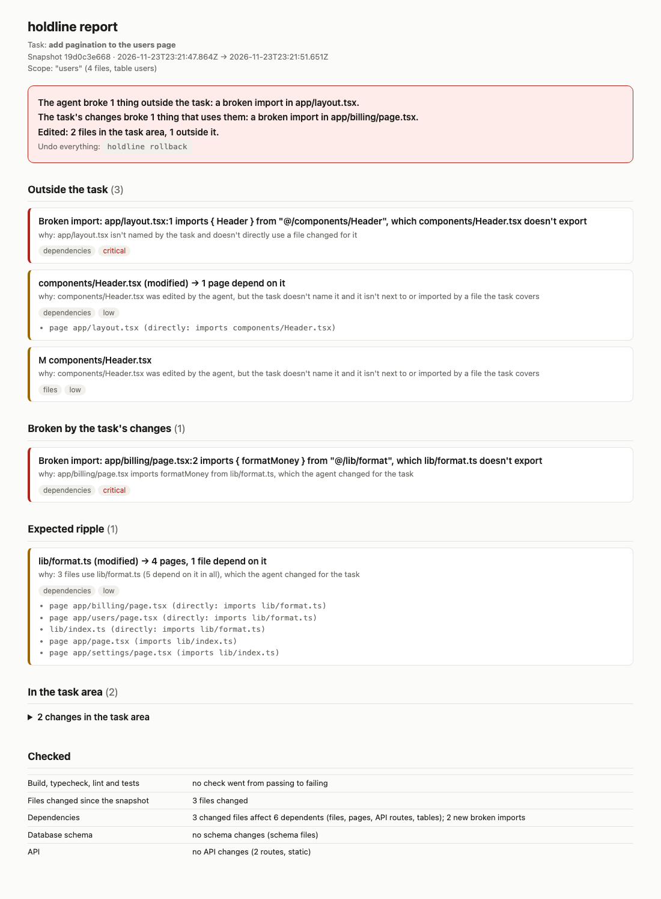

# holdline

[](https://github.com/moabbas7/holdline/actions/workflows/ci.yml)
[](LICENSE)

**Catches what AI coding agents break outside the task you gave them.**

You ask an agent to add pagination to the users page. It does, and on the way it renames a shared helper and tidies up a header component. The users page works, so the task looks done, but the billing page and the site layout now import things that no longer exist. holdline snapshots your project before the agent starts, checks it again afterwards, and tells you what broke outside the task, with one command to put everything back.


<sub>A real recording of the commands below on a small Next.js app ([how it was made](scripts/record-demo.mjs)).</sub>

Every `after` also writes a self-contained HTML report:



## Quick start

holdline is installed from GitHub (it isn't on npm). In a git repo with a JavaScript or TypeScript project:

```sh
npm install -D github:moabbas7/holdline
npx holdline init
npx holdline before --task "add pagination to the users page"
# … let the agent work …
npx holdline after
npx holdline rollback      # only if you want to undo the whole task
```

To try it without adding it to the project, use `npx github:moabbas7/holdline <command>` instead of `npx holdline <command>`.

**With Claude Code**, run it once and holdline runs around every prompt by itself:

```sh
npx holdline install-hooks
```

When you send a prompt it records a baseline. When Claude finishes it runs `after`, and if something outside the task broke, Claude is told what broke and fixes it before handing back (at most 2 rounds). You see one line: nothing broken, fixed, or what's still broken. Details in [docs/claude-code.md](docs/claude-code.md).

## What it checks

| Probe | What it catches |
| --- | --- |
| **Checks** | Build, typecheck, lint or tests that passed before and fail now, linked to the files and lines in the output. |
| **Dependencies** | Imports that now point at a missing file or export, and the blast radius of every changed file: imports, API calls and database tables, across workspaces. |
| **Database** | Dropped or renamed tables and columns, type changes, new NOT NULL columns, row-level security turned off, from migrations, Prisma, Drizzle or a local database (read-only), and the code that still uses them. |
| **API** | Routes or methods removed while still called, response fields removed or retyped, request fields that became required, success responses that became errors, and the lines that read them. |
| **Visual** (opt-in) | Pages that stop loading, go blank, show an error screen or log new console errors, in a real browser at desktop and mobile width, plus screenshot diffs. |

Every rule is in [docs/probes.md](docs/probes.md).

## Task scope

Most of what an agent changes is the task. holdline matches the task text against the project (paths, routes, component names, table names, plain words like "users"), adds anything you pass with `--scope "<glob>"`, and then sorts every finding by how it relates to the task, each with a one-line `why`. From the recording above (some lines left out):

```text
Outside the task (3)
  ✗ Broken import: app/layout.tsx:1 imports { Header } from "@/components/Header", which components/Header.tsx doesn't export
      why: app/layout.tsx isn't named by the task and doesn't directly use a file changed for it
  …

Broken by the task's changes (1)
  ✗ Broken import: app/billing/page.tsx:2 imports { formatMoney } from "@/lib/format", which lib/format.ts doesn't export
      why: app/billing/page.tsx imports formatMoney from lib/format.ts, which the agent changed for the task

Expected ripple (1)
  ~ lib/format.ts (modified) → 4 pages, 1 file depend on it
  …

In the task area: 2 changes (holdline after --all to list them)
```

- **Outside the task**: things the task wasn't about. Shown first.
- **Broken by the task's changes**: code that uses something the task changed, and now breaks.
- **Expected ripple**: code that depends on the task's changes and changed without breaking.
- **In the task area**: collapsed to a count. A regression here is still shown.

`after` exits with 1 when anything regressed. Scope is decided locally and deterministically, with no AI or network calls: [docs/task-scope.md](docs/task-scope.md).

## Safety

- **Local only.** No accounts, no cloud, no telemetry. Data lives in `.holdline/` (git-ignored) and in git refs under `refs/holdline/`.
- **Your git state is left alone.** Snapshots never touch your branch, index or stash list. Rollback asks first, saves the current state so `holdline undo-rollback` can bring it back, and never moves branches.
- **Databases are read, never written.** Every query runs in a read-only transaction against the system catalogs, and is rolled back. holdline connects only to local hosts (`localhost`, `127.0.0.1`, Docker service names) unless you list a host in `allowHosts`, never reads `.env.production*`, and never prints connection strings or passwords.
- **Production is never touched.** The dev server for the API and visual checks refuses to start when its database URL points at a non-local host, and only the requests you list are sent.
- **holdline never asks the agent to roll back.** Undoing a task is your decision.
- **Hooks fail open.** If holdline isn't configured, is busy, times out or crashes, the hook exits quietly and that turn simply isn't checked. Text from your project that is sent to the agent is marked as data and stripped of anything that looks like instructions.

## Using it with other agents

holdline doesn't depend on any one agent. Around Cursor, Codex, Aider or anything else, run `before` when a task starts and `after` when it ends. `after --json` gives a [documented, versioned report](docs/report-schema.md) to feed back to the agent:

```sh
npx holdline before --task "add pagination to the users page"
# … let the agent work …
npx holdline after --json | jq -r '.findings[] | select(.kind == "regression" and (.scope == "outside-scope" or .scope == "broken-by-task")) | "\(.title) (\(.files | join(", "))): \(.reason)"'
```

The exit code of `after` is 1 when anything regressed, so it also works in scripts and CI. More in [docs/claude-code.md](docs/claude-code.md#other-agents-cursor-codex-aider-).

## Requirements and limits

- **Node 22.13 or later and git.** CI runs on Linux, macOS and Windows with Node 22.13, 22 and 24.
- **Built for JavaScript and TypeScript projects.** `init` recognises Next.js, Vite/React and Node projects, and the dependency and API analysis read JS/TS (Next.js route handlers and Express, Fastify and Hono-style routes). In other projects you still get the checks you configure, the file changes and rollback.
- **Git-ignored files aren't snapshotted** (`node_modules/`, an ignored `.env`, build output), so rollback doesn't restore them.
- **Rollback restores files, not databases.** When the live schema changed during the task, holdline says so and leaves it to you.
- **Static analysis has gaps.** URLs built from variables aren't followed, aliases defined only in bundler config aren't read, and API shapes typed as `any` are reported as unknown rather than guessed. Unknown never counts as a regression.
- **The visual check is opt-in and slower.** It needs Playwright in your project and starts your dev server, which typically adds 30–70 seconds to `before`.
- **Next.js 16.4+ with `experimental.agentUpgrade`** won't start `next dev` inside an agent, so the visual and live API checks are skipped when run from a hook ([details](docs/claude-code.md#nextjs-and-agent-detection)).
- **One Claude session per project is tracked at a time.**

## Docs

- [Commands](docs/commands.md): every command, option and exit code
- [Task scope and the report](docs/task-scope.md)
- [Probes](docs/probes.md): checks, dependencies, database, API, visual
- [Configuration](docs/configuration.md): every `.holdline/config.json` key
- [Claude Code hooks](docs/claude-code.md)
- [Snapshots and rollback](docs/snapshots.md)
- [JSON report schema](docs/report-schema.md)
- [Contributing](CONTRIBUTING.md) · [Security](SECURITY.md)

## License

[MIT](LICENSE)
